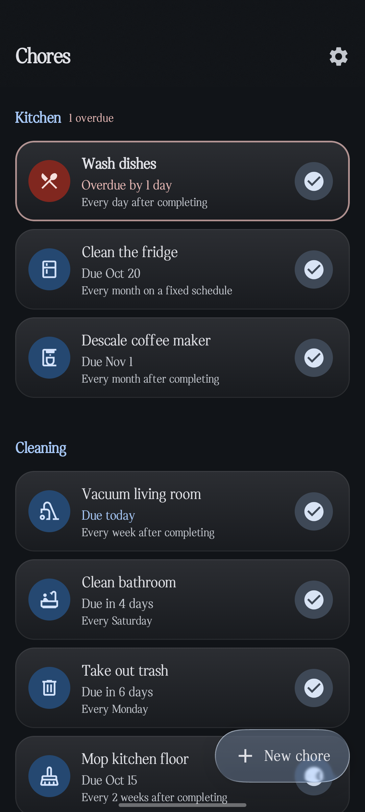
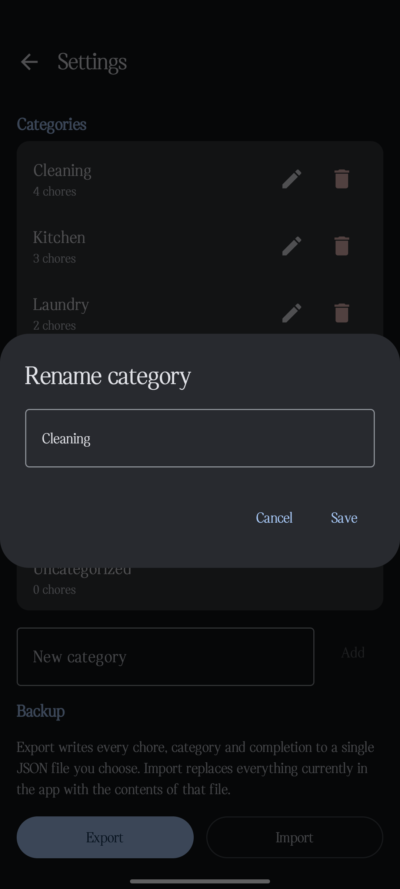
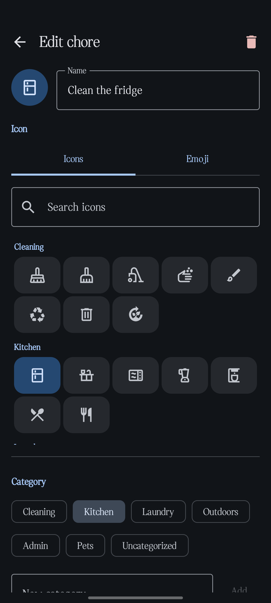
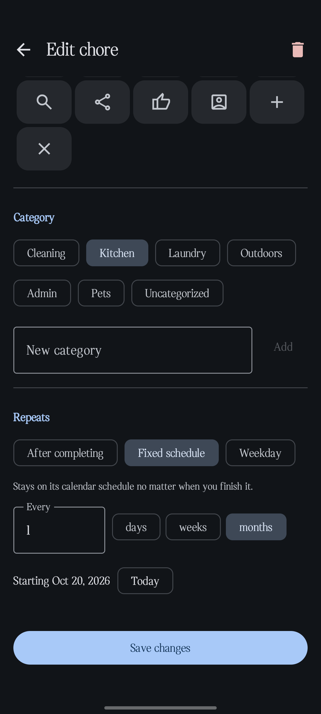
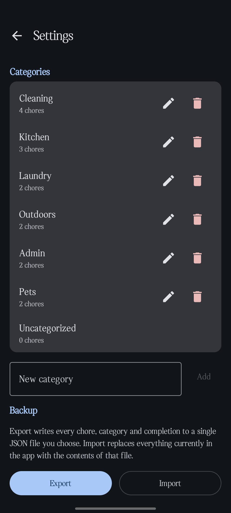
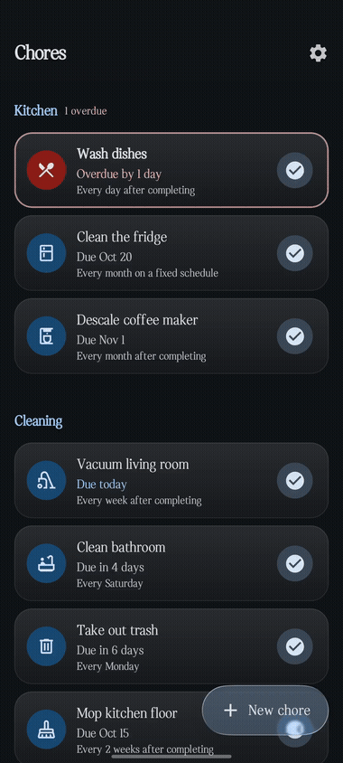
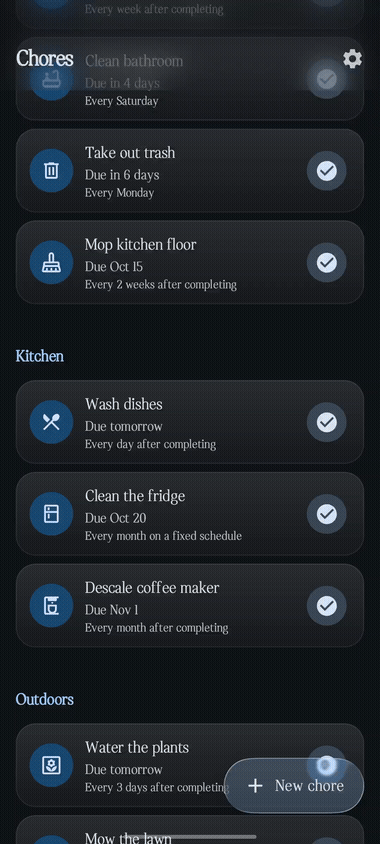
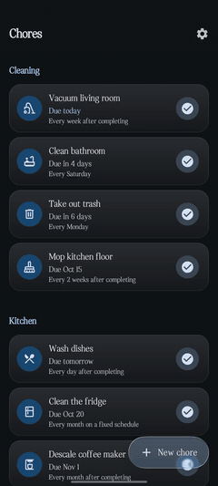

# Chore Reminder



An Android app for the chores that are too small or too frequent to put on a calendar: vacuuming, changing bed sheets, feeding the cat, cleaning out the fridge. You mark something done, it figures out when it's due again. No account, no server, nothing syncing anywhere.

I kept trying to use my calendar for this and hating it. Chores don't have a time of day, they repeat on their own schedule, and "done" should bump the next occurrence forward instead of leaving a stale event sitting there. None of that maps onto a tool built for meetings, so I built something that only has to think about one kind of thing.

It's deliberately small. Add a chore, set how often it repeats, get told when it's due, tick it off. There's no streak counter and no points, because I didn't want this turning into another app I have to manage.

<br clear="left"/>

## What it does



Chores live in categories you define yourself — Kitchen, Laundry, Admin, Pets, whatever matches how you actually think about your place. Rename one and everything under it follows along automatically. Delete one and its chores get reassigned to Uncategorized rather than disappearing, since renaming a folder shouldn't be how you lose a chore's history by accident.

<br clear="right"/>



Picking an icon for a chore doesn't mean scrolling through a dozen icons that have nothing to do with housework. `material-icons-extended` would've added 66 MB to the APK just to get a handful of usable icons, so I pulled out a set of about 100 and grouped them by category — cleaning, kitchen, laundry, outdoors, admin, pets. If none of them fit, the system emoji keyboard is right there too (🐱 covers "feed the cat" just fine). Type a name like "Water plants" or "Take out bins" and a Recommended row appears above the groups with a guess at the right icon, picked by matching words in the name against each icon's label and keywords — it's a suggestion, not something that auto-applies.

<br clear="left"/>



The part I spent the most time getting right is recurrence, because chores don't all repeat the same way. Watering the plants should reschedule from whenever you actually got to it — every 3 days from today, not from some grid. Rent is different: it's due on the 15th no matter whether you paid early or late. There are four options:

- **Relative** — next due date is completion date plus the interval. Forgiving if you're late.
- **Fixed interval** — anchored to a date, regardless of when you complete it.
- **Weekday** — repeats on the same day each week.
- **One-off** — due once, with no repeat.

Completing a fixed occurrence early advances to the following scheduled occurrence. The original schedule stays intact, including month-end dates. Completing a relative chore early or late counts its next interval from the day you actually finished.

Upcoming chores can appear immediately, a chosen time after completion, or a chosen time before their next due date. Set a default in Settings and override it for individual chores. Due and overdue chores always remain visible; the eye button lets you reveal hidden upcoming chores whenever you need to edit them.

Completing a chore shows a short **Task completed / Undo** confirmation. Undo restores that specific occurrence, including one-off chores. The list keeps your scroll position by default, with an option in Settings to follow the completed chore instead.

Not every chore that's due is a chore you can actually do right now. Swipe a card right, long-press it, or hit Delay… on the notification to push it back an hour, three hours, to tomorrow, or to a date you pick — the card picks up a tertiary "Delayed" badge instead of the usual overdue red until the snooze runs out. If a chore just shouldn't count this time around, swiping the other way or picking Skip asks you to confirm first (with a "Delay instead" escape hatch), then moves the occurrence on without logging it as done. Both delay and skip get the same undo pill as completing does.

<br clear="right"/>



Settings groups appearance, chore behaviour, categories, notifications and backups in one place. Export writes every chore, category, completion and visibility rule to a JSON file you control. Import confirms before replacing your current data. Older backup files remain readable; appearance and scrolling preferences stay local to the device.

When something's due, you get a notification with Mark Complete, Delay… and Skip… actions right on it, so you don't have to open the app at all for the common cases. Leave it incomplete and it will remind you again each day. Reminders target 09:00 local time, with delivery subject to notification permissions and Android's background scheduling.

There's also a home screen widget, for the chores you want visible without unlocking the phone. It resizes from a compact "3 chores due" at its smallest up to a list grouped by category at its largest, with its own settings (reachable from the widget picker or by resizing it later) for whether it shows upcoming chores too, icons, compact rows, and background opacity.

The color scheme follows your wallpaper on Android 12+ and respects system light/dark mode. Buttons and confirmation dialogs use Liquid Glass, with adjustable blur and a live sample in Settings. The scrolling header uses a separate progressive backdrop blur; chore cards keep a simpler translucent surface for readability.

<br clear="left"/>

## A few demos

<table>
<tr>
<td><br/><sub>Completing an overdue chore and advancing its due date</sub></td>
<td><br/><sub>Opening the new-chore form from the glass action button</sub></td>
<td><br/><sub>Scrolling through categories on the home screen</sub></td>
</tr>
</table>

## Offline, for real

The app does not request `INTERNET`. It uses Android notifications and background work, with no app account or backend. That's not an oversight I forgot to fix — the whole point of this app was getting chores off a cloud-synced to-do list and onto a device that doesn't care if it has signal.

## Built with

Kotlin and Jetpack Compose (Material 3), with an MVVM setup and a small repository layer in between. Room handles storage, WorkManager fires the reminders, DataStore holds preferences, and kotlinx.serialization writes the backup JSON. The frosted-glass bits use [Haze](https://github.com/chrisbanes/haze) for the blur and [Kyant0's backdrop/shapes libraries](https://github.com/Kyant0/AndroidLiquidGlass) for the liquid-glass refraction on buttons and confirmation dialogs. The home screen widget is built with Jetpack Glance rather than classic RemoteViews XML, so it shares the same Compose-like layout code as the rest of the app.

The recurrence math lives in an Android-free Kotlin package within the app module, which made it easy to throw a real test suite at it — interval math, month-end clamping (Jan 31 rolls to Feb 28, then recovers to Mar 31), leap years, the due/overdue boundary.

There's no DI framework. It's four screens and a hand-rolled container in `ChoreApp.kt` does the job without pulling in Hilt for something this size.

## Running it

Use Android Studio with Android SDK platform 37 and a Java 17 toolchain. The app runs on Android 12 or later (minSdk 31).

```bash
./gradlew :app:installDebug
```

Local release builds are signed with the debug key on purpose. This isn't going on the Play Store, so the only thing that matters is being able to drop the APK on my phone and install it.

## What's not here

No multi-user support, no cloud sync, no calendar integration, no exact-alarm permission dialogs, no streaks or badges. Each of those got left out on purpose rather than cut for time — this is meant to stay a small app that does one thing, not grow into a second calendar.

## License

MIT — see [LICENSE](LICENSE).
